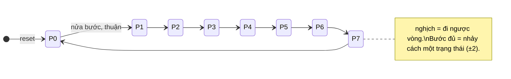

# 01 · Đặc tả F08 — FSM điều khiển động cơ bước (M1)

> **BẢN ĐỀ XUẤT.** Các quyết định ở §3 là lựa chọn hợp lý, chưa phải đáp án duy nhất.
> Trước khi dùng: đọc từng quyết định, tự hỏi "nếu thầy hỏi vì sao thì mình trả lời được không",
> sửa chỗ nào em muốn khác, và ghi việc dùng AI vào phần khai báo cuối báo cáo.
> Ba chỗ nên hỏi thầy xác nhận được đánh dấu **[HỎI THẦY]**.

## 1. Bối cảnh và mục tiêu
Khối điều khiển động cơ bước cho trục quay của máy in 3D mini. Động cơ bước hai cuộn (bốn đầu pha A, B, C, D) quay một bước mỗi khi dòng điện được chuyển sang pha kế tiếp theo một thứ tự cố định. Khối này **chỉ sinh chuỗi pha**; mạch công suất (transistor/driver) nằm ngoài chip.

**Tầng trên cần gì:** ba lệnh (chiều, chế độ bước, chạy/dừng) và bốn dây pha để nối vào driver; thêm chỉ số vị trí để biết đang ở đâu trong chuỗi.

**Câu hỏi kỹ thuật của em** (lấy từ charter §4.1, có thể thay bằng câu của riêng em):
1. Bước đủ (4 trạng thái) và nửa bước (8 trạng thái) dùng chung hay riêng thanh ghi trạng thái, và chi phí flip-flop khác nhau bao nhiêu?
2. Đổi chiều hoặc đổi chế độ giữa chừng: FSM làm gì để không mất bước, không nhảy bước?
3. Số ô nhớ dự đoán là bao nhiêu, phần nào dành cho vị trí trong chuỗi?

## 2. Bảng giao diện
Ngân sách chân: 3 bit vào + 7 bit ra = 10 trên 24 chân Tiny Tapeout.

| Tín hiệu | Chiều | Độ rộng | Mức tích cực | Ý nghĩa | Giả định |
|---|---|---|---|---|---|
| `clk` | vào | 1 | cạnh lên | xung nhịp duy nhất; mọi thanh ghi đổi ở cạnh lên | Tần số do tầng trên chọn. Đặc tả **không đặt yêu cầu tần số** |
| `rst_n` | vào | 1 | thấp | đưa FSM về vị trí 0 | Hạ bất đồng bộ, nhả đồng bộ với `clk` (tầng trên bảo đảm). Không có bộ đồng bộ hoá bên trong |
| `uio_in[0]` = `dir` | vào | 1 | 0 = thuận, 1 = nghịch | chiều quay | Đồng bộ với `clk`, ổn định quanh cạnh lên |
| `uio_in[1]` = `half` | vào | 1 | 1 = nửa bước, 0 = bước đủ | chế độ bước | như trên |
| `uio_in[2]` = `run` | vào | 1 | 1 = chạy | cho phép tiến một bước ở cạnh lên | như trên |
| `uo_out[3:0]` = `phase` | ra | 4 | cao = cấp điện cuộn | bit0 = A, bit1 = B, bit2 = C, bit3 = D | Driver ngoài chip, cực tính do tầng trên lo |
| `uo_out[6:4]` = `pos` | ra | 3 | — | vị trí trong chuỗi 8 điểm nửa bước, **số không dấu 0–7** | Chỉ là chỉ số, không phải góc tuyệt đối |
| `uo_out[7]` | ra | 1 | — | không dùng, luôn 0 | — |
| `uio_oe[7:0]` | ra | 8 | — | luôn `0x00` (mọi chân `uio` dùng làm vào) | — |
| `uio_out[7:0]` | ra | 8 | — | luôn `0x00`, không có tác dụng vì `uio_oe = 0` | — |
| `ui_in[7:0]`, `uio_in[7:3]`, `ena` | vào | — | — | không dùng | Nối vào `_unused` có chủ ý |

- **Signedness:** không áp dụng. `pos` là số không dấu.
- **Latency:** 1 chu kỳ. Giá trị `dir/half/run` lấy mẫu ở cạnh lên thứ *n* thì `phase/pos` mới hiện ra ngay sau cạnh đó.
- **Reset:** sau reset, `pos = 0`, `phase = 0001`.
- **Kiểu ngõ ra:** Moore. `phase` và `pos` chỉ phụ thuộc trạng thái hiện tại, không phụ thuộc trực tiếp vào đầu vào.

## 3. Quyết định đặc tả và lý do
| # | Câu hỏi mở | Quyết định đề xuất | Lý do / hệ quả |
|---|---|---|---|
| D1 | "Tốc độ" không có chân điều khiển | **Một bước mỗi chu kỳ `clk` khi `run = 1`.** Tốc độ quay do tầng trên quyết định bằng tần số `clk` hoặc bằng cách bật/tắt `run` theo nhịp mong muốn. Không có bộ chia xung bên trong. **[HỎI THẦY]** | Không có chân tốc độ; gia tốc ngoài phạm vi; bộ chia sẽ thêm nhiều flip-flop, lệch ước lượng 4–6 ô nhớ của charter |
| D2 | Hai chuỗi 4 và 8 trạng thái | **Dùng chung một thanh ghi `pos` 3 bit.** Nửa bước: `pos` ±1. Bước đủ: `pos` ±2 | Một thanh ghi, không cần chuyển đổi trạng thái khi đổi chế độ |
| D3 | Bước đủ dùng kiểu nào | `pos` chẵn → một pha mỗi lần (A,B,C,D); `pos` lẻ → hai pha mỗi lần (AB,BC,CD,DA). Parity của `pos` giữ nguyên trong chế độ bước đủ. **[HỎI THẦY]** | Không cần "căn lại" `pos` khi đổi chế độ; cả hai kiểu đều là bước đủ hợp lệ |
| D4 | Đổi chế độ giữa chừng | Chế độ mới có hiệu lực **ở bước kế tiếp**; ở thời điểm đổi, `pos` không bị sửa | Căn lại `pos` sẽ gây nhảy nửa bước ngoài ý muốn |
| D5 | Đổi chiều giữa chừng | `dir` được lấy mẫu mỗi chu kỳ; đổi `dir` thì bước kế tiếp đi **từ `pos` hiện tại** theo chiều ngược lại. Không mất bước, không nhảy | Vị trí là trạng thái duy nhất; đảo bảng mà quên vị trí hiện tại mới gây mất bước |
| D6 | `run = 0` | **Giữ nguyên** `pos` và `phase`, cuộn vẫn có điện (giữ vị trí). Không có chế độ tắt coil | Giữ mô-men; ngoài phạm vi: giảm dòng giữ |
| D7 | Reset | `rst_n = 0` ⇒ `pos = 0` ngay (bất đồng bộ). Ưu tiên cao hơn `run` | Điểm bắt đầu xác định, kiểm thử lặp lại được |
| D8 | Trạng thái không hợp lệ | Với `pos` 3 bit mọi giá trị 0–7 đều hợp lệ, không có trạng thái cấm. Nếu đổi sang mã hoá khác (one-hot…) phải nêu cách xử lý trạng thái cấm | Gắn với câu phân tích riêng về mã hoá |
| D9 | Đầu vào bất thường | Cả 8 tổ hợp `(dir, half, run)` đều có hành vi xác định. Đầu vào không đồng bộ với `clk` là vi phạm giả định ở §2 | Không xử lý metastability trong khối |

## 4. Hành vi

**Phương trình** (ở mỗi cạnh lên của `clk`, `rst_n = 1`; cộng/trừ theo modulo 8):

```
s        = half ? 1 : 2
pos_next = run ? (dir ? pos - s : pos + s) : pos
```

**Bảng pha theo vị trí** (thứ tự bit: `phase[3:0]` = D C B A):

| `pos` | Cuộn cấp điện | `phase[3:0]` |
|---|---|---|
| 0 | A | 0001 |
| 1 | A + B | 0011 |
| 2 | B | 0010 |
| 3 | B + C | 0110 |
| 4 | C | 0100 |
| 5 | C + D | 1100 |
| 6 | D | 1000 |
| 7 | D + A | 1001 |



**Trường hợp biên cần có trong kiểm chứng:**
- Vòng đệm: thuận 7→0, nghịch 0→7; bước đủ 6→0 và 7→1 (và chiều ngược).
- Một vòng đầy đủ: 8 bước nửa bước hoặc 4 bước bước đủ thì quay về đúng `pos` ban đầu.
- Đổi chiều đúng chu kỳ vừa đổi chế độ; đổi chiều tại điểm vòng đệm.
- Đổi chế độ khi `pos` lẻ và khi `pos` chẵn (D3, D4).
- `run` bật/tắt ngay trước và sau một cạnh lên.
- Reset giữa lúc đang chạy; reset khi `run = 1` (D7).
- Cả 8 tổ hợp `(dir, half, run)` (D9).

**Bất biến cấp đặc tả** (để viết assertion ở M2):
- **I1.** `run = 0` ở một cạnh lên (và `rst_n = 1`) ⇒ `pos` và `phase` không đổi.
- **I2.** `run = 1` ⇒ `pos` đổi đúng ±1 (nửa bước) hoặc ±2 (bước đủ) theo modulo 8.
- **I3.** `phase = bảng(pos)` ở mọi thời điểm sau reset.
- **I4.** Trong chế độ nửa bước, mỗi bước chỉ đổi đúng **một** bit của `phase`.
- **I5.** `uo_out[7] = 0` và `uio_oe = 0x00` luôn luôn.

## 5. Giả định phân tích (không phải yêu cầu)
`CLOCK_PERIOD` trong `config.json` chỉ là giả định để chạy STA. Slack dương chỉ có nghĩa "đạt ở chu kỳ giả định đó", không được viết thành "mạch chạy được ở X MHz".

## 6. Ngoài phạm vi
Vi bước, điều khiển dòng, gia tốc/giảm tốc, phản hồi vị trí; chế độ tắt cuộn; chế tạo, tape-out, sign-off.

## 7. Ánh xạ chân Tiny Tapeout
`ui_in` (8 chân chỉ vào): không dùng · `uo_out` (8 chân chỉ ra): `[3:0]` pha, `[6:4]` vị trí, `[7]` = 0 · `uio` (8 chân hai chiều): `[2:0]` làm chân vào (`dir/half/run`), `[7:3]` không dùng, `uio_oe = 0`. Đủ trong ngân sách 24 chân, không phải đổi gì.
