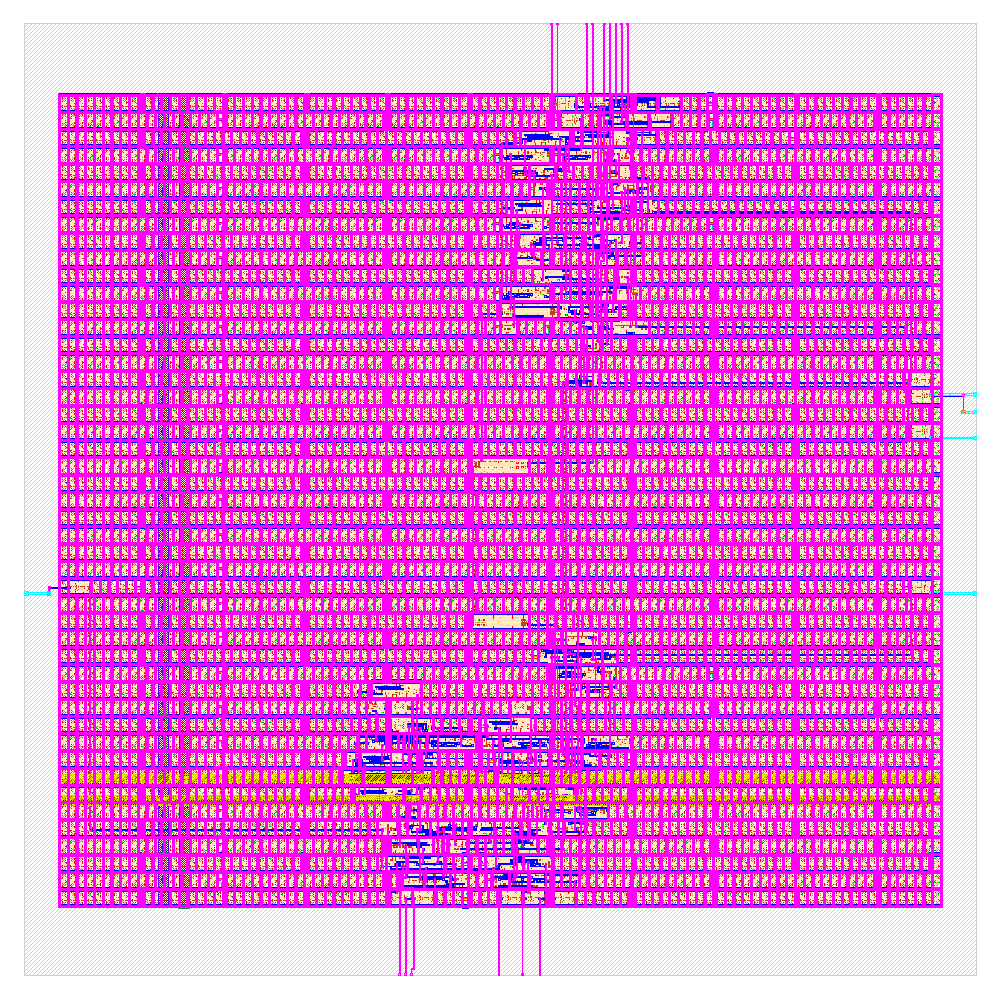

# F08 - Bộ điều khiển động cơ bước

Dự án thiết kế bộ điều khiển động cơ bước F08 bằng SystemVerilog, thực hiện mô phỏng, tổng hợp logic và thiết kế vật lý để tạo file GDSII bằng LibreLane.

## 1. Tổng quan dự án

Dự án xây dựng mạch điều khiển động cơ bước với khả năng điều chỉnh chiều quay, chế độ bước và tốc độ điều khiển.

### Các chức năng chính

- Thiết kế mạch RTL bằng SystemVerilog.
- Điều khiển chiều quay của động cơ.
- Hỗ trợ chế độ bước đủ (Full-step) và nửa bước (Half-step).
- Điều chỉnh tốc độ thông qua bộ chia tần số.
- Mô phỏng RTL bằng Icarus Verilog.
- Tổng hợp logic bằng Yosys.
- Thiết kế vật lý và tạo file GDSII bằng LibreLane.
- Xem và kiểm tra layout bằng KLayout.

## 2. Ảnh layout thiết kế vật lý

## 3. File GDSII

File GDSII được tạo từ quy trình thiết kế vật lý:

[`f08_stepper_ctrl.gds`](04_IMPLEMENTATION/gds/f08_stepper_ctrl.gds)

File này chứa dữ liệu layout vật lý của thiết kế, có thể mở bằng phần mềm hỗ trợ định dạng GDSII như KLayout.

## 4. Kết quả kiểm tra thiết kế

Quy trình LibreLane đã hoàn thành 80/80 giai đoạn.

- **DRC:** Passed — các kiểm tra quy tắc thiết kế vật lý đã đạt.
- **LVS:** Passed — kiểm tra đối chiếu layout và sơ đồ kết nối đã đạt.
- **Antenna:** Passed — kiểm tra antenna đã đạt.

Lưu ý: Quá trình thiết kế vẫn ghi nhận một số cảnh báo, bao gồm hai net bị thả nổi và việc sử dụng cấu hình timing mặc định. Cần xem xét các báo cáo liên quan trước khi kết luận thiết kế đáp ứng đầy đủ yêu cầu timing hoặc sẵn sàng sản xuất.

## 5. Công cụ sử dụng

- **SystemVerilog:** Mô tả phần cứng RTL.
- **Icarus Verilog:** Mô phỏng RTL.
- **Yosys:** Tổng hợp logic.
- **LibreLane:** Quy trình thiết kế vật lý từ RTL đến GDSII.
- **KLayout:** Hiển thị và kiểm tra layout.
- **SkyWater SKY130 HD:** Thư viện cell tiêu chuẩn sử dụng trong thiết kế vật lý.
# tranthuhongF08

